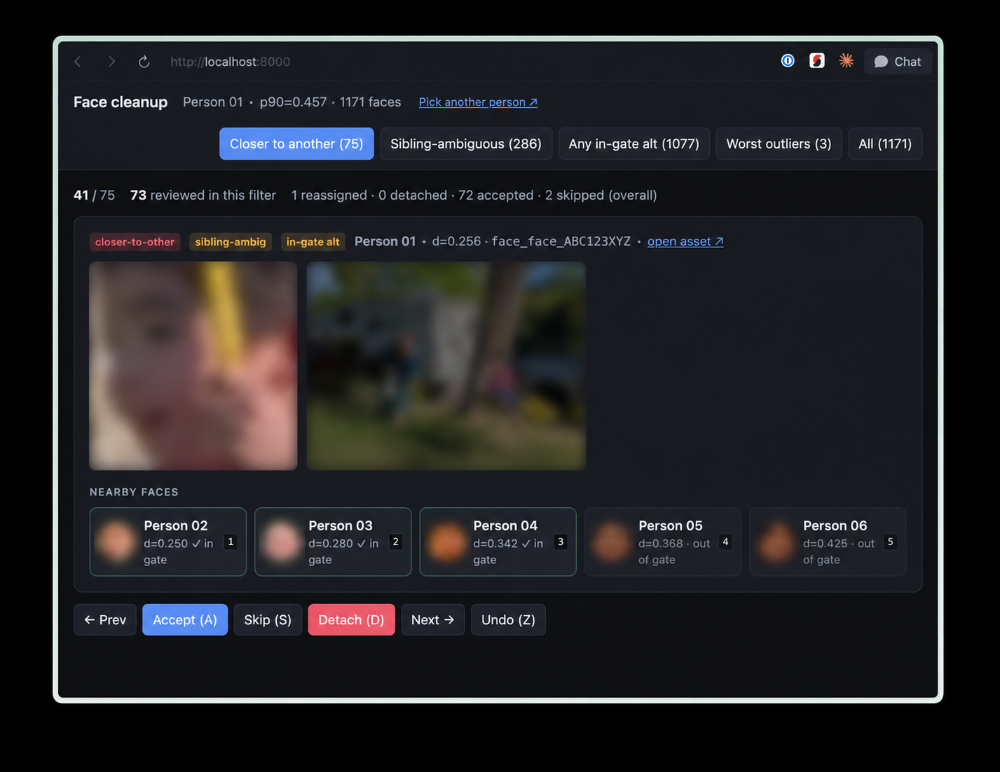
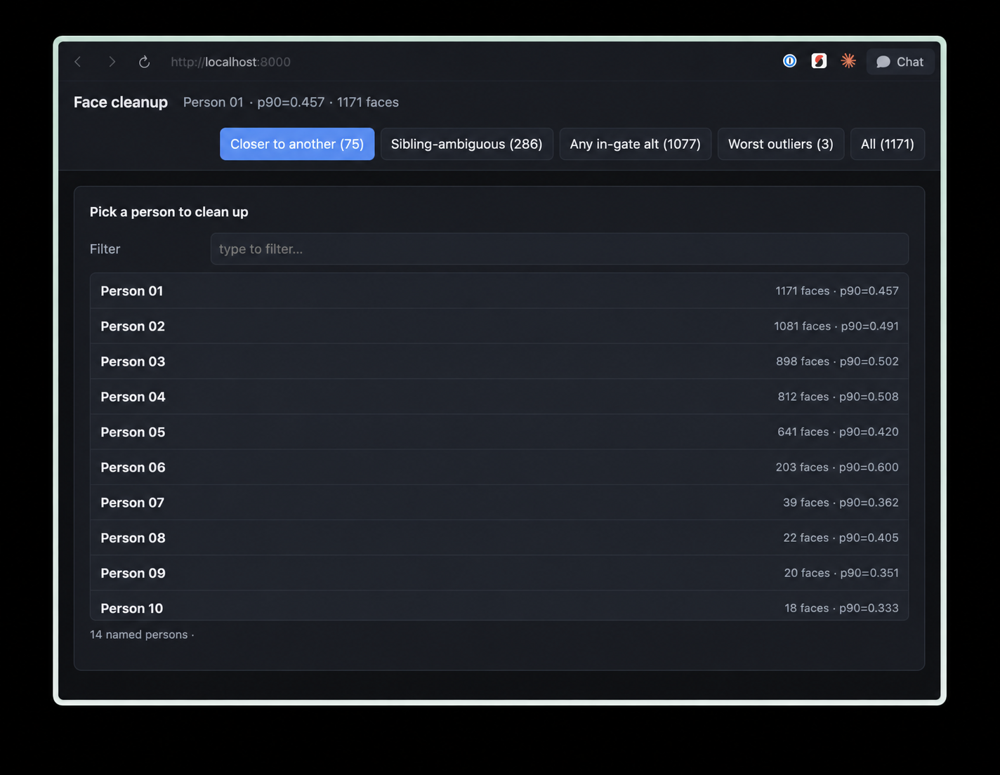

# Face cleanup

Browser-only triage UI for cleaning up a [Gumnut](https://gumnut.ai)
Person's face cluster. Useful when one Person has been polluted by
look-alikes — usually a parent/child or sibling pair — and you want to
sweep through the worst-fitting faces and reassign them.

It's a single static HTML file. No build step, no server, no
dependencies beyond a browser and a way to serve a directory locally.



> ⚠️ **Mutates your library.** This demo's main job is to call
> `PATCH /api/faces/{id}` to move faces between people (or detach them).
> Every reassignment, detach, and acceptance of an assigned face is real and
> immediate. Accept records the existing assignment as manually confirmed.
> Undo (`Z`) reopens local review or makes another ordinary assignment.
> It cannot reverse server history or restore automatic assignment provenance.

## Quick start

```bash
git clone https://github.com/gumnut-ai/demos.git
cd demos/face-cleanup
./run.sh
```

`run.sh` starts a local static server and opens `http://localhost:8000/`
in your browser. If you don't want the script:

```bash
python3 -m http.server 8000     # or: npx serve .
open http://localhost:8000/
```

In the page:

1. **API base URL**: leave as `https://api.gumnut.ai` (the default).
2. **API key**: paste your personal Gumnut API key. ([Get one](https://gumnut.ai).)
3. **Library**: if your account has more than one library, pick one.
   Single-library accounts skip this step.
4. **Person**: every person in the library — both **named** and
   **unnamed** clusters — laid out in a thumbnail grid, biggest cluster
   first. Type in the filter to narrow named entries down by name; clear
   the filter to see unnamed clusters. Click a card to start triaging.



The credentials, library ID, and active subject persist in
`localStorage`, so reload returns you to the same view.

## How to triage

The header tabs filter the face list. The first five tabs review faces
that are **already on the subject** — looking for misassignments to
reassign or detach. The last two tabs are the inverse: faces currently
on *other* people, or unassigned entirely, that may belong to the
subject.

| Tab | Meaning |
| --- | --- |
| Closer to another | Faces where some other named Person's centroid is **nearer** than the subject's. Highest-confidence misassignments. |
| Sibling-ambiguous | Faces where the closest *other* Person is within `sibling_margin` (0.05) of the subject's distance — production assignment picks the nearer centroid here even though next-best is barely worse. |
| Any in-gate alt | Faces where some other Person is within the production assignment distance gate (0.35). The biggest "could-have-gone-elsewhere" pool. |
| Worst outliers | Faces with `d_current` ≥ `outlier_distance` (0.45), sorted descending. Surfaces faces far from the subject's centroid even when no competing centroid is nearby — typically wrong-identity faces with no clear alternate destination. |
| All | All faces, worst-first. |
| Could be on subject | The inverse view: faces currently assigned to **other** Persons whose nearest-candidate list contains the subject AND where the subject is closer than the face's current Person. Shows up as "currently: \<other name\>" with a single "Reassign to subject" candidate button. Lazy-loaded the first time you open the tab — fans out to every neighboring Person, so it's slower than the other tabs on first click. |
| Unassigned candidates | Faces currently assigned to **no Person** (`person_id` is null) whose nearest-candidate list contains the subject — production clustering left them unassigned but still considered them close to the subject's centroid. Shows up as "currently: unassigned" with the nearby named Persons offered as destination buttons (closest first, the subject among them) so you can assign the face to whichever identity fits. The face list itself is ordered closest-to-subject first. Lazy-loaded on first click; walks every face in the library (no `person_id IS NULL` server-side filter), so on big libraries this is slower than the inverse tab. |

### Provenance and review scope

By default, all tabs exclude manually created face boxes and faces whose
current assignment source is manual. Check **Include manually created or
assigned faces** to review them too. The count beside the checkbox describes
manual faces excluded or included in the selected tab; tab counts use the same
scope. This option starts unchecked on each page load.

Each face shows **Box** provenance separately from **Assignment** provenance.
Automatic assignments distinguish ingest, clustering, and automatic merges.
Manual assignments include client/API/MCP edits, Accept confirmations, and
manual person merges; they do not prove someone inspected that individual face.
Unassigned faces are labeled Unassigned. Unknown assignment provenance stays
included, with a visible count; an older API that omits `assignment_source`
also appears as Unknown rather than being guessed automatic or manual.

A manually drawn box has no embedding, so it has no fit distance or nearby
candidates. When included, it can appear in All and Worst outliers because
missing distances sort first; that is not evidence the box or identity is wrong.

Filtering is applied when selecting a tab or changing the checkbox. The current
queue stays navigable after an edit so Prev and Undo can still reach that face,
even after Accept changes its assignment source to manual. Successful writes
update the displayed assignment provenance from the API response.

### Per-face actions

| Key | Action |
| --- | --- |
| `1`–`5` (or click a candidate) | `PATCH /api/faces/{id}` with that Person's id. |
| `D` | Detach — `PATCH /api/faces/{id}` with `person_id: null`. Clears the saved assignment; later automatic assignment follows the backend's review policy. |
| `A` | Accept — saves the person displayed on the face as a manual assignment, then hides the face. In **Could be on subject**, this confirms the displayed other person. For unassigned faces, only hides the face locally. |
| `S` | Skip — local-only mark; doesn't touch the server. |
| `Z` | Undo the most recent in-session action. Accept/Skip only reopen local review. For reassignment/Detach, makes a fresh assignment or clear using the previous displayed person. It does not restore earlier review state, reverse server history, or restore automatic provenance. |
| `←` / `→` | Navigate without acting. |

Reviewed faces are tracked in `localStorage`
(`fcd:reviewed:{personId}`, keyed per subject) so closing the tab and
coming back later doesn't make you re-walk what you've already done.
Switching subjects starts a fresh reviewed map.

Actions use the current assignment displayed in this session, including the
assignment returned by a successful edit. The server applies the requested
person (or null) even if another client changed the owner since the view loaded;
there is no displayed-owner check. Reload fetches current server assignments,
while local reviewed marks remain per subject. If a request fails or its response
is lost, the face stays available, but the write may already have saved. Reload
to check its current assignment before retrying. Navigation, filters, and subject
changes are blocked while a write is pending.

After a batch of reassignments the centroid shifts; click **Pick
another person ↗** in the header and re-pick the same subject to
rebuild against the new centroid.

## What it calls

The dashboard is a pure consumer of the public API. For a chosen
subject Person it calls:

- `GET /api/people/{id}?include=cluster_metrics` — header (name, p90,
  face count).
- `GET /api/people?library_id=…&include=cluster_metrics&name_filter=all`
  — picker grid (named + unnamed), candidate-thumbnail prefetch, and
  per-candidate "cluster loose" badges.
- `GET /api/faces?person_id=…&library_id=…&include=cluster_assignment`
  (paginated) — every face on the subject, with `distance_to_person`
  and the top-K nearest other Persons in the same response. The
  **Could be on subject** tab fans the same call out across every
  neighboring Person, then keeps faces whose candidate list contains
  the subject closer than their current Person.
- `GET /api/faces?library_id=…&include=cluster_assignment` (no
  `person_id`, paginated) — every face in the library, used by the
  **Unassigned candidates** tab. Walked client-side to keep rows whose
  `person_id` is null AND whose candidate list contains the subject.
- `GET /api/faces/{id}` and `GET /api/assets?ids=…&include=variants` — face-crop
  and parent-asset URLs plus the bbox overlay (lazy + prefetched). The variants
  expansion supplies the larger preview URL for click-to-enlarge; asset reads
  without it return only a thumbnail. Only thumbnail image bytes are prefetched;
  the lightbox loads the preview when opened. Video assets use their extracted
  still-image variants; video originals are not loaded into image elements.
- Face responses expose `source` for box creation and `assignment_source` for
  the current person link. Deploy the backend exposing `assignment_source`
  before relying on the demo to hide manual assignments; older responses can
  still hide manual boxes but cannot identify manual assignments.
- `PATCH /api/faces/{id}` — reassignments, detaches, and confirmations
  (Accept sends the current person ID). Requires an API version that records
  same-person assignments as manual confirmations; older versions return
  success without changing provenance. Deploy that backend support before
  using Accept for confirmation. Earlier local-only acceptances are not
  retroactively confirmed. Assignment and Detach use the same endpoint whether
  or not backend review recording is enabled. Durable review recording and
  automatic assignment enforcement require their backend rollout; this client
  does not enable or verify that rollout.

Per-face flags (`closer_to_other`, `sibling_ambig`,
`within_distance_gate`) are derived in the browser from the closest
*named* candidate's distance. `cluster_assignment.candidates` includes
unnamed clusters too, but unnamed clusters can't serve as a candidate
*destination* (no name to render on the button), so they're filtered
out before flag computation. The subject itself **can** be unnamed —
the picker lists both — and the standard tabs work the same against
unnamed subjects, just with `(unnamed)` in the header.

## Tuning

The thresholds at the top of `index.html` mirror the production
face-clustering constants used during assignment:

```js
const DISTANCE_GATE     = 0.35;
const COHESION_GATE     = 0.65;
const SIBLING_MARGIN    = 0.05;
const CANDIDATE_WINDOW  = 0.6;
const OUTLIER_DISTANCE  = 0.45;
```

If Gumnut tunes its production thresholds, the `Closer to another` /
`Sibling-ambiguous` / `Any in-gate alt` tabs may skew until these are
updated. The dashboard still works either way — assignment results from
the API are unchanged — only the suggestion-tab framing depends on
them. `OUTLIER_DISTANCE` is dashboard-only.

## Security

The page sends your API key on every request. **Don't host this on a
shared origin without an auth front-door** — just run it locally and
access via `localhost`. The API key only lives in your browser's
`localStorage`, and the API only ever returns data scoped to the
libraries you own.

## Layout

- `index.html` — the dashboard. Vanilla JS, ES modules, no build step.
- `run.sh` — tiny launcher: starts `python3 -m http.server` and opens
  the page.
- `test-actions.mjs` — credential-free action regression tests. Run with
  `node --test test-actions.mjs` (Node.js 22+); no packages to install.
